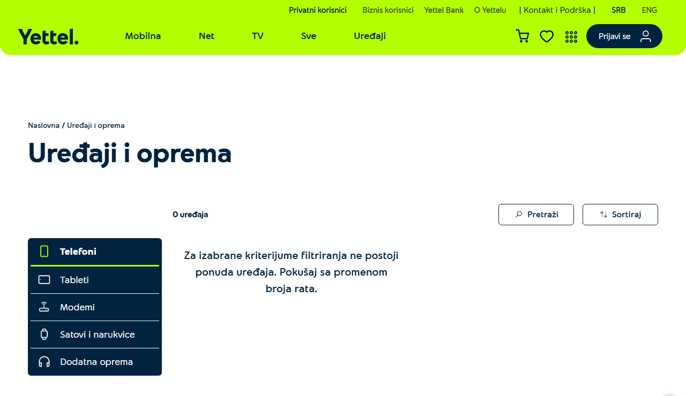

# Yettel Webshop – Playwright Tests

UI and API test automation for the [Yettel Serbia webshop](https://www.yettel.rs/webshop/sr/), built with Playwright and TypeScript. It covers the purchase flow from the phones catalog through product configuration (colour, tariff) to adding the bundle to the cart.

## Highlights

- **Found a bug in the live webshop ([BUG-001](#bug-001-catalog-api-failure-is-shown-as-no-devices-match-your-filters)):** when the catalog API fails, users see "0 uređaja" and are told to change their installment count, instead of an error message with a retry option.
- 14 automated tests across smoke, end-to-end and API suites. Smoke and API tests run in GitHub Actions on every push.
- API data is cross-checked against what the page renders, and the failure path is tested by mocking a 500 response.
- The cart test verifies the exact device, colour and tariff sent in the order request, which is answered inside the test browser so no order is ever created.

## How the site was tested

- Tests only read public catalog data. No orders, accounts or personal data are involved.
- Every test runs with a safety guard that aborts any write request to the checkout API (`/bff/checkout/*`) in the browser. Tests that need the cart step to succeed answer that request locally with a fake response.
- The API failure is simulated only inside the test browser by intercepting the request, so that request never reaches Yettel's servers.
- No load or security testing was done. Tests run with 2 parallel browsers at most.

## What is covered

| Suite | File | What it checks |
|---|---|---|
| Smoke | `tests/smoke/catalog-smoke.spec.ts` | Catalog loads, cards show a model name and a monthly price in the right format |
| E2E | `tests/e2e/catalog-filters.spec.ts` | Brand, RAM and plan filters, combined filters, clearing filters, sorting by lowest price |
| E2E | `tests/e2e/tariff-and-cart.spec.ts` | Tariff selection updates the device installment and total, colour variant updates the summary, the selected bundle is sent to the cart |
| API | `tests/api/catalog-api.spec.ts` | Catalog API contract, API data vs. rendered cards, behaviour when the API returns 500 |

## Project structure

```
src/
  api/        API config, URL matchers, response checks and the checkout safety guard
  data/       test data (filters, sort option, bundle selection)
  fixtures/   Playwright fixtures that provide page objects and the safety guard
  pages/      page objects (BasePage, CatalogPage, ProductDetailPage, CheckoutPage)
  types/      TypeScript types for test data, API responses and the order request
tests/
  smoke/  e2e/  api/
docs/         screenshots for bug reports
```

## How to run

Requirements: Node.js 20+.

```bash
npm ci
npx playwright install chromium
```

| Command | Runs |
|---|---|
| `npm test` | all tests |
| `npm run test:smoke` | smoke tests |
| `npm run test:e2e` | filter, sort, tariff and cart tests |
| `npm run test:api` | API tests |
| `npm run test:ci` | smoke and API tests (what CI runs) |
| `npm run test:headed` | all tests with a visible browser |
| `npm run typecheck` | TypeScript check |
| `npm run report` | opens the HTML report of the last run |

Tests run with 2 workers, because more parallel browsers can get their connections reset by the site. If a run fails with `net::ERR_CONNECTION_RESET` or a timeout on `page.goto`, the site was not reachable. Wait a minute and run again.

CI runs the type-check plus smoke and API tests on every push and pull request to `main` that changes this folder, and uploads the HTML report when a run fails (see `.github/workflows/yettel-webshop-playwright.yml` in the repo root).

## Out of scope: checkout form

The "Tvoji podaci" (your details) form is not tested. The webshop only shows it after its server saves a real order (`POST /bff/checkout/order`, protected by reCAPTCHA). Reaching it would mean creating orders in production, so the suite stops at the cart step and verifies the order request instead. On a real project this would run against a test environment.

## Bugs found

### BUG-001: Catalog API failure is shown as "no devices match your filters"

| Field | Value |
|---|---|
| **Severity** | Medium |
| **Area** | Phones catalog (`/webshop/sr/Privatni-korisnici/Mobilni-telefoni/`) |
| **Environment** | Chrome desktop, production, November 2026 |
| **Automated test** | `tests/api/catalog-api.spec.ts` → "reproduces BUG-001: catalog API 500 is shown as an empty result list" |

#### Steps to reproduce

1. Open https://www.yettel.rs/webshop/sr/ in Chrome.
2. Open DevTools (F12), go to the **Network** tab.
3. Right-click any request, choose **Block request URL**, then edit the blocked pattern to `*bff/pages/products*`.
4. Click **Telefoni** in the category menu.

#### Expected result

The page says the catalog could not be loaded and offers a way to retry.

*Based on common e-commerce UX practice; no product specification was available.*

#### Actual result

The page shows **"0 uređaja"** and this message:

> Za izabrane kriterijume filtriranja ne postoji ponuda uređaja. Pokušaj sa promenom broja rata.
>
> *(There are no devices for the selected filter criteria. Try changing the number of installments.)*

No filters are selected, and changing the number of installments cannot fix a failed request. A user would think the shop has no phones, not that something failed. The same happens when the API returns HTTP 500 (this is what the automated test does).



#### Notes

The page does not crash and there are no JavaScript errors, so the failure is handled. It is just shown with the wrong message. The automated test checks the current behaviour, so it will fail once this is fixed. That is the signal to update it.
